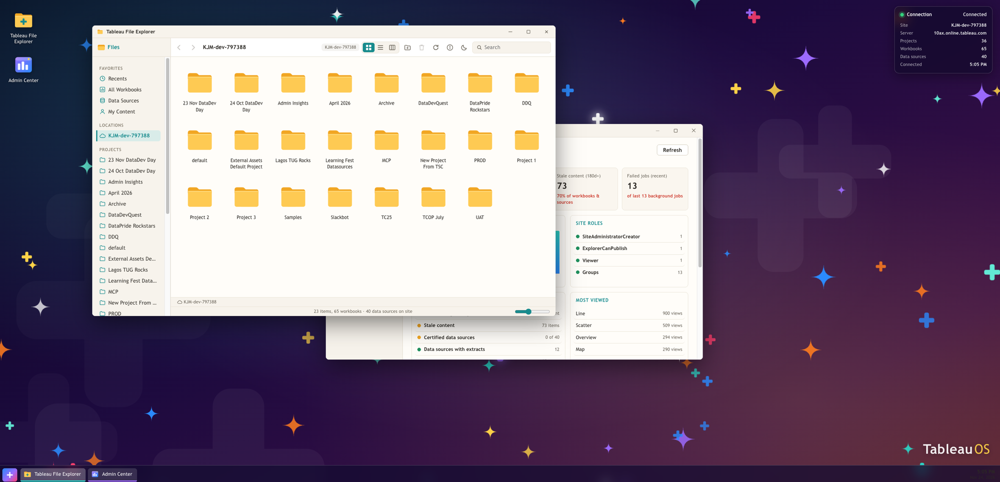

> **⚠️ This Data App is for demo/inspiration purposes only. Use at your own risk!**

# TableauOS

A Tableau data app that presents a Tableau site's projects, workbooks and data sources as a small desktop
(file browser, taskbar, windows, themes) with an Admin Center. **For Tableau site administrators only.**

## How it works
- Runs inside Tableau as a viz extension and calls the REST API through `tableau.extensions.fetchAsync`, i.e. with
  the signed-in user's own session. No server URL, site name, or token is configured anywhere in the code; the
  site and user are read from `GET /sessions/current`.
- Non-admin users see a non-dismissable "administrators only" modal.
- Outside Tableau (plain browser) you can connect with a Personal Access Token. Server URL, site and token are typed
  into the Connection window and stored only in your browser. Never commit credentials.

## Site setup (REST allowlist)
Tableau Cloud sites restrict which REST endpoints a data app may call through the host bridge. Until an admin lists
them, TableauOS shows a "Site setup needed" screen. Yes, you have to do this by hand.

### Steps
1. Sign in to your site as a site admin and go to **Settings > Packages > Settings**.
2. Under **Allowed Origins for Packages**, add your pod origin (for example `https://your-pod.online.tableau.com`).
3. Under **Tableau REST API Access**, click **Add path** and enter a path, then pick its HTTP methods.
4. Repeat for every row in [`rest-allowlist.csv`](rest-allowlist.csv). Column 1 is the path, column 2 is the methods.
5. Reload TableauOS. If a call is denied, the error shows the exact path that was checked; add that row.

### Gotchas
- Matching is an **exact string comparison** against the URL *template* the app passes to `fetchAsync`, before
  placeholders are filled. Paste paths exactly as written: leading `/api`, literal `{api-version}`, `{site-id}`
  and other `{...}` placeholders, and **no trailing slash**. `/api/{api-version}/sites/{site-id}/` is not
  `/api/{api-version}/sites/{site-id}`.
- Don't use real LUIDs or version numbers; Tableau fills `{api-version}` and `{site-id}`, and the app passes every other
  ID through `options.urlVariables`.
- Query strings (`?pageSize=...`) don't need their own rows.

### A word on the UI
There is currently no API, CSV import, bulk paste or config file for this list. It is roughly 35 rows of clicking,
typing and choosing methods from a dropdown, one at a time, through the web UI, and it has to be redone on every site.
I have complained about this to the Tableau dev team. They acknowledged it, which is lovely, and I'm sure it's
fine. Until that changes, put on a podcast.

## Build and publish
    ./build.sh            # produces build/TableauOS.twbx
Publish the `.twbx` to your site (Tableau Cloud/Server) from Desktop or via the REST API / Tableau MCP, and allow the
extension on the site if required.

## Layout
- `TableauOS.twb` - workbook shell
- `Packages/com.tableau.mcp.tableau-finder/` - extension (`content/src/*.js|css`, `config.js`, `manifest.json`)
